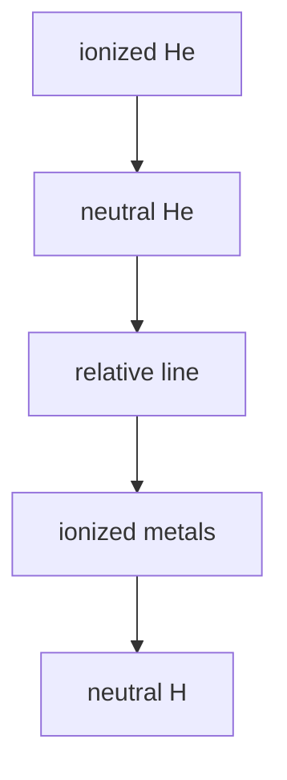

## 星等和测光

两种星等系统：

* Vega 系统：用 Vega 的光谱作为标准谱，标定其他星体的星等. Vega 在各通带处均为 0 等；

* AB 系统：用 Vega 在 v 波段流量密度 $3631\text{ J}\_{\text{y}}$ 作为统一零点定标.

  一般 AB 系统用于巡天测光.

绝对星等定义为天体在 $10$ pc 处的星等，
$$
M = m-5\log\_{10}\left(\frac{D}{10\text{ pc}}\right)
$$
为绝对星等和视星等之间不考虑消光的关系.

消光同时改变亮度与颜色，因此引入色指数
$$
B-V=m\_B-m\_V
$$
越蓝的恒星，其 $B-V$ 越小，色指数可以表征恒星的光谱形状. 但是上面的定义也没有考虑消光，同时对于极其遥远的星系还要做一些宇宙学修正，即所谓的 K 修正.

***

测光系统：

* Johnson 系统：U, B, V 三色测光.
* SDSS ugriz 测光系统：技术进步之后 Sloan 数字巡天计划引入了新的测光系统，很好地覆盖了可见光频率，分为 u, g, r, i, z 五个波段.
* Strömgren uvby 系统：这是一个中带系统，覆盖范围比上面两个系统要窄，主要区分连续谱、金属线遮蔽与 Balmer 跃变，一般用于恒星的各项参数的研究.

消光：尘埃散射后，光谱不只是强度被削弱，其中心波长还会被红化，向红端偏移.

> 已知消光最大的恒星 LBV 1806-20，在尘埃云后面，在可见光下只有 35 等，但是红外光下可以测出有 8 等.

## 光谱和 H-R Diagram

恒星特征谱线的强度表征其温度.

::: center

*这是随着温度变高，一些典型的特征谱线.*

:::

更细节地，对于每一个元素，在不同温度下会产生特殊的谱线.

Harvard 光谱分类，将恒星分为 O, B, A, F, G, K, M 几个类别；当然在此基础上还可以定义恒星的二元光谱分类，也就是星和矮星. 但是 Harvard 分类并不能够唯一确定恒星在 H-R 图上的位置，因此 Yerkes 天文台的天文学家们根据谱线宽度的变化提出了 Yerkes 光谱分类.

> 主序星的体积小，大气密度高，因此压力高、碰撞频繁，导致谱线展宽；反之巨星谱线更尖锐.
>
> 谱线致宽机制包括不确定性原理造成的自然展宽，以及碰撞造成的 Dopler 展宽. 通过这些机制可以更细致地分类恒星.

在这个分类下，分为七个恒星光度级，Ia (最亮超巨星), Ib (次亮超巨星), II (亮巨星), III (巨星), IV (亚巨星), V (矮星), VI (亚矮星), VII (白矮星). 其中 V 星也就是主序星序列.

::: tip

双星的研究意义：验证引力定律，同时它们之间的对比可以更精确的对比物理特性.

:::

## 恒星结构方程

主要讨论下面一些方程：

* 质量分布
* 流体静力学平衡
* 恒星内部温度、压强及其他物态参数
* 能量守恒
* 能量传输
* 恒星结构

静力学平衡条件为
$$
\frac{\mathrm{d}P(r)}{\mathrm{d}r}=-\frac{GM(r)\rho(r)}{r^2}
$$
