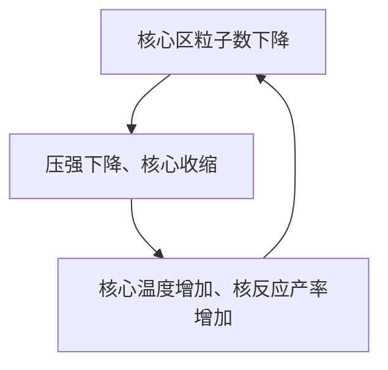

## 辐射转移方程

用 $S\_\nu=j\_\nu/k\_\nu$ 描述介质发射和吸收系数之比，称为源函数，
$$
\frac{-1}{\kappa\_\nu\rho}\frac{\mathrm{d}I\_\nu}{\mathrm{d}s}=I\_\nu-S\_\nu
$$
为辐射转移方程. 也就是经过任何距离，光强 $I\_\nu$ 都会向 $S\_\nu$ 接近. 在任意方向上，辐射转移方程加上一个深度和三角函数：
$$
\cos\theta\frac{\mathrm{d}I\_\nu}{\mathrm{d}\tau\_\nu}=I\_\nu-S\_\nu
$$
这个 $\tau\_\nu$ 仍然受制于对频率的依赖；但是可以通过所谓「灰大气」近似，考虑不透明度不随着波长变化，则写成一个 $\tau\_\nu=\tau$ 的版本.

辐射转移方程的解为 (在灰大气近似下，且考虑径向辐射)
$$
I\_\nu(0)=I\_\nu e^{-\tau\_\nu}-\int\_{\tau\_{\nu0}}^0S\_\nu e^{-\tau\_\nu}\mathrm{d}\tau\_\nu
$$
(从光深为 $\tau\_{\nu0}$ 位置积分到大气表面.) 即通过某个深度的光强计算出大气表面的光强. 如果要计算不同层大气沿视线方向的强度贡献，假定光线从无穷深开始发出，则
$$
I\_\nu(0) = \int\_0^\infty S\_\nu\sec\theta\cdot e^{-\tau\_\nu\cos\theta}\mathrm{d}\tau\_\nu
$$
如果对 $S\_\nu$ 做近似，可以得到一个比较简单的定性式子：$I\_\nu=a\_\nu+b\_\nu\cos\theta$. 这个式子能够解释太阳的所谓「临边昏暗」效应，也就是在 $\theta\to\pi/2$ 的时候光强急剧衰减.

## 多方模型

多方模型属于一种零级近似的模型，非常简单.

回忆之前的结构方程，如果加上 $P$, $\kappa$, $\varepsilon$ (核能产生率) 三个额外关系，能够把这三个关系转换为幂律. 在这种考量下，我们考虑静力学平衡方程：
$$
\frac{\mathrm{d}P(r)}{\mathrm{d}r}=-\frac{GM(r)\rho(r)}{r^2}\Longrightarrow\frac{\mathrm{d}}{\mathrm{d}r}\left(\frac{r^2}{\rho}\frac{\mathrm{d}P}{\mathrm{d}r}\right) = -G\frac{\mathrm{d}M}{\mathrm{d}r}
$$
右边用质量守恒方程替代，且定义 $P=K\rho^{1+1/n}$，则得到
$$
\frac{(n+1)K}{4\pi nG}\frac{1}{r^2}\frac{\mathrm{d}}{\mathrm{d}r}\left(\frac{r^2}{\rho^{1-1/n}}\frac{\mathrm{d}\rho}{\mathrm{d}r}\right)=-\rho
$$
这个方程在 $0\leqslant r\leqslant R$ 的范围内的解称为 **多方球**. 它需要两个边界条件，因此由 $K$, $n$ 和 $R$ 这三个参数唯一确定，这允许我们计算 $P(r)$, $M(r)$ 等.

无量纲化：$\rho=\rho\_c\theta^n$，则
$$
\left\[\frac{K(n+1)}{4\pi G}\rho\_c^{1/n-1}\right]\frac{1}{r^2}\frac{\mathrm{d}}{\mathrm{d}r}\left(r^2\frac{\mathrm{d}\theta}{\mathrm{d}r}\right)=-\theta^n
$$
令
$$
\lambda\_n^2=\frac{K(n+1)}{4\pi G}\rho\_c^{1/n-1}, \quad r=\lambda\_n\xi
$$
则得到 Lane-Emden 方程：
$$
\frac{1}{\xi^2}\frac{\mathrm{d}}{\mathrm{d}\xi}\left(\xi^2\frac{\mathrm{d}\theta}{\mathrm{d}\xi}\right) = -\theta^n\quad \left\[\frac{\mathrm{d}^2\theta}{\mathrm{d}\xi^2}=-\frac{2}{\xi}\frac{\mathrm{d}\theta}{\mathrm{d}\xi}-\theta^n\right]
$$
其数值解表明，多方指数越小，对应恒星模型的质量具有更大的中心聚集性.

::: tip

多方模型在致密星的研究中能够起到比较大的作用，因此仍未过时.

:::

红巨星等温氦核：
$$
M\_r=4\pi\rho\_cr^3\left(-\frac{1}{\xi}\frac{\mathrm{d}\theta}{\mathrm{d}\xi}\right)\Longrightarrow M\_c\sim\rho\_c^{3(1-n)/(2n)},\quad R\_c\sim M\_c^{1/3}
$$
当然等温氦核质量不能无限升高，到一定程度时中心温度达到 $10^8$ K，此时 He 被点燃，小质量的恒星会触发氦闪，而大质量恒星直接进入稳定 He 燃烧阶段.

> 人们用 TRGB 星体的氦闪作为一种标准烛光使用.

## HR Diagram 与恒星分类

* 主序阶段：大部分的恒星都落在 HR 图中的一个窄带 (主序带) 上，这条带质量范围很大，主序星具有均匀的化学组成、氢燃烧的核、以及完全流体静力学平衡的状态.

  刚刚进入氢燃烧的恒星处于主序带最左侧，之后沿着主序带向右下移动.

具体的演化：

大质量恒星会一直演化到中心形成铁核，无法再进行聚变，之后中心铁核塌缩导致超新星爆炸；而小质量恒星的演化终点为白矮星.
